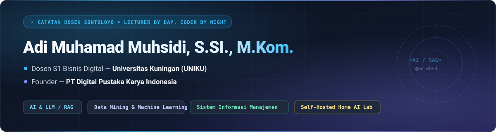

  

   

  

   

  

    
    
    
    
  

  

    
    
    
    
    
    
  

  

    
  

---

## 👨‍💻 Tentang Saya (*Catatan Dosen Sontoloyo*)

Halo! Saya **Adi Muhamad Muhsidi, S.SI., M.Kom.**, seorang akademisi dan praktisi teknologi dari Kuningan, Jawa Barat, Indonesia.

- 🎓 **Akademisi:** Dosen Program Studi **S1 Bisnis Digital**, Fakultas Ekonomi dan Bisnis (FEB), **Universitas Kuningan (UNIKU)**.
- 🏢 **Kewirausahaan:** Pendiri & Pemilik **PT Digital Pustaka Karya Indonesia** ([pustakakarya-id.web.app](https://pustakakarya-id.web.app/)).
- 🔬 **Fokus Karya:** Mengembangkan aplikasi dan sistem berbasis **Artificial Intelligence (LLM, RAG, AI Agent)**, **Data Mining**, **Machine Learning**, dan **Web / Self-Hosted Infrastructure** yang bersifat praktis, realistis, serta berdampak langsung bagi pendidikan, kampus, dan UMKM.
- 💬 **Moto:** *"Whatever we do, people always have something to say."*

### 📊 Ringkasan Metrik Akademik & Teknologi

| SINTA Overall | SINTA 3Yr | Sitasi Google Scholar | Karya Ilmiah | Buku Ber-ISBN | Hak Cipta (HKI) | Repositori GitHub |
| :---: | :---: | :---: | :---: | :---: | :---: | :---: |
| **500** | **352** | **75+** *(h-index 6, i10-index 1)* | **36+** | **7 Buku** | **10 HKI** | **103+ Repos** |

### 🧠 Bidang Keahlian & Mata Kuliah yang Diampu

<table width="100%">
  <thead>
    <tr>
      <th width="420" align="left">🔬 Bidang Keahlian &amp; Riset</th>
      <th width="420" align="left">📚 Mata Kuliah (FEB Universitas Kuningan)</th>
    </tr>
  </thead>
  <tbody>
    <tr>
      <td width="420" valign="top">
        <ul>
          <li>System Builder &amp; Automation</li>
          <li>Artificial Intelligence (LLM, RAG, AI Agents)</li>
          <li>Machine Learning &amp; Data Mining</li>
          <li>Big Data Analytics &amp; Business Intelligence</li>
          <li>Decision Support System (DSS)</li>
          <li>Cloud &amp; Self-Hosted Infrastructure</li>
        </ul>
      </td>
      <td width="420" valign="top">
        <ul>
          <li>Machine Learning &amp; Artificial Intelligence</li>
          <li>Big Data Analytics &amp; Data Mining</li>
          <li>Pemrograman Python</li>
          <li>Pemrograman Aplikasi Mobile</li>
          <li>Literasi Teknologi</li>
          <li>Sistem Informasi Manajemen</li>
        </ul>
      </td>
    </tr>
  </tbody>
</table>

---

## 🛠️ Tech Stack & Daily Tools (*Lecturer by Day, Coder by Night*)

#### 🎨 Frontend & Web

  
  
  
  
  
  

#### ⚙️ Backend & Database

  
  
  
  
  
  
  

#### 🤖 Data Science, AI & Automation

  
  
  
  
  
  
  
  
  

#### ☁️ Cloud, DevOps & Home Lab

  
  
  
  
  
  
  
  
  

---

## 📜 Rekam Jejak Akademik Pilihan

  
<strong>🔬 Hibah Penelitian Kompetitif &amp; Internal (2024–2026)</strong>

  1. **2026 — Penelitian Kompetitif Nasional (PFR - BIMA Kemdiktisaintek):** *Perancangan Sistem AI-Based Adaptive Learning untuk Personalisasi Bias Informasi dalam Penguatan Critical Digital Literacy (CDL) Guru* (Rp 140.400.000).
  2. **2026 — Hibah Internal (PDP) Universitas Kuningan:** *Pengembangan Sistem E-Catalogue Berbasis AI dengan Algoritma Content Based Filtering untuk Personalisasi Pemasaran Digital*.
  3. **2026 — Hibah Internal (PDP) Universitas Kuningan:** *Pemilihan Tanaman Reklamasi Pasca Tambang Galian C Berbasis Agroekologi di Desa Cileuleuy*.
  4. **2024 — Hibah Internal (PK) Universitas Kuningan:** *Analisis Perilaku Pembelian dan Prediksi Konsumen pada Usaha Retail dengan Metode Data Mining*.

  
<strong>📚 Buku Referensi, Buku Ajar Ber-ISBN &amp; Seri Modul Ber-HKI (7 Buku &amp; 10 HKI)</strong>

  - *Pengembangan Sistem Informasi Manajemen untuk Digital Bisnis* (2025)
  - *Kolaborasi untuk Literasi Digital dalam Dunia Pendidikan: Perspektif Dosen, Guru, Mahasiswa & Komunitas Pendidikan* (2025)
  - *Everyday Digital Safety: Panduan Dasar Melindungi Diri di Dunia Maya* (2025)
  - *Pengantar Bisnis: Fundamentals of Modern Business* (2024)
  - *Pengantar Ilmu Komputer* & *ICT dan Multimedia* (2024)
  - *Seni Berkomunikasi dalam Dunia Bisnis: Menguasai Teknik Komunikasi di Era Digital dan Global* (2024)
  - *Literasi Teknologi & Informasi: Buku Wajib Masyarakat Digital di Era Revolusi Industri 4.0 menuju Society 5.0* (2024)
  - **Seri Modul Praktikum Ber-HKI (FEB Universitas Kuningan):** Pemrograman Web, Sistem Basis Data, Pemrograman Dasar, Pemrograman Dasar Lanjutan, Machine Learning & AI, Big Data Analytics, dan Pemrograman Aplikasi Mobile.

---

## 🐍 Aktivitas & Kontribusi GitHub

  <picture>
    <source media="(prefers-color-scheme: dark)" srcset="https://raw.githubusercontent.com/adimhsd/adimhsd/output/github-contribution-grid-snake-dark.svg" />
    <source media="(prefers-color-scheme: light)" srcset="https://raw.githubusercontent.com/adimhsd/adimhsd/output/github-contribution-grid-snake.svg" />
    
  </picture>

---

  <blockquote>
    <em>“Jika kamu berbuat baik, maka kamu bisa memimpin. Jika kamu tidak membutuhkan orang lain maka kamu akan setara. Jika kamu membutuhkan seseorang, maka kamu akan menjadi budak.”</em>
     
    <strong>— Sayyidina Ali bin Abi Thalib RA</strong>
  </blockquote>
   
  ⚡ <em>“A sontoloy human being, nothing more nothing less.”</em> • <a href="https://adi-muhamad.my.id">adi-muhamad.my.id</a>

